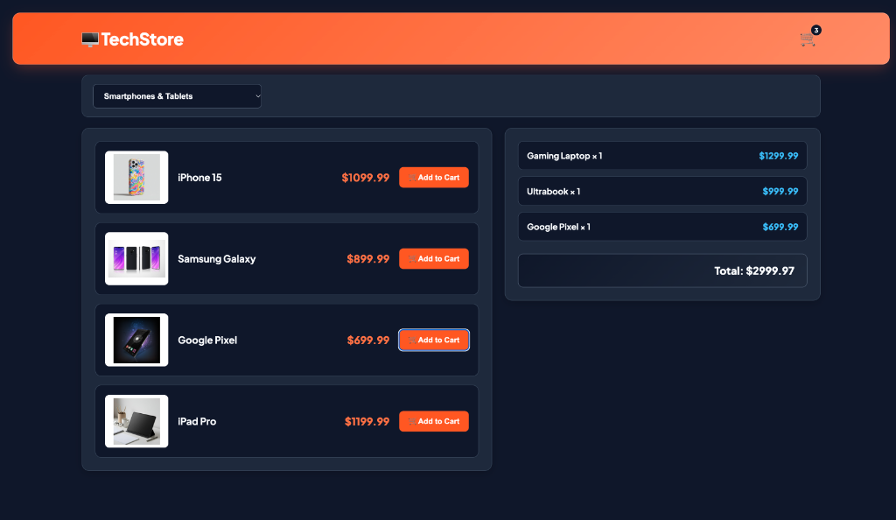
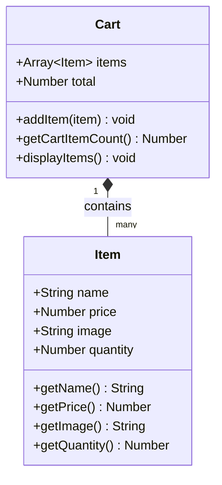

# 🛒 TechStore — Object-Oriented JavaScript E-Commerce Platform

[](https://developer.mozilla.org/en-US/docs/Web/JavaScript)
[](https://developer.mozilla.org/en-US/docs/Web/HTML)
[](https://developer.mozilla.org/en-US/docs/Web/CSS)
[](#responsive-web-design)
[](LICENSE)

A modular, Object-Oriented JavaScript (OOP) dynamic electronics store catalog and real-time shopping cart application. Features dynamic product filtering, quantity aggregation, line-item subtotaling, and modern responsive styling.

---

## 📸 Visual Guide & Interface Walkthrough

### Dynamic Product Catalog & Real-Time Aggregated Cart
The user interface features a split-pane layout with category filtering on the left and a live-updating shopping cart summary on the right.

<div align="center">
  
</div>

- **Category Filtering**: Dropdown menu instantly filters between *Computers & Laptops* and *Smartphones & Tablets* without page reloads.
- **Dynamic Product Rendering**: Cards are programmatically created with high-res thumbnails, product titles, currency-formatted prices, and action buttons.
- **Live Cart Panel**: Aggregates selected products with multi-quantity tracking (`Gaming Laptop × 1`, `Ultrabook × 1`, `Google Pixel × 1`), itemized prices, and a live-calculated grand total (`Total: $2999.97`).
- **Header Badge Counter**: Synchronizes immediately with total units in the cart (shown with active badge count of `3`).

---

## 🧠 Technical Highlights & JavaScript Concepts

| Concept | Description & Implementation |
| :--- | :--- |
| **Object-Oriented Programming (OOP)** | Modular `Cart` and `Item` classes encapsulating state, getters, and behavior |
| **Array Methods & Higher-Order Functions** | Utilizes `Array.prototype.find()` for item lookup and `Array.prototype.reduce()` for total sum aggregation |
| **Dynamic DOM Creation** | Programmatic card generation via `document.createElement()`, attributes, and event binding |
| **Deferred Script Execution** | `defer` script loading ensuring strict dependency ordering without render-blocking |
| **Formatted Currency Calculations** | Numerical floating-point arithmetic formatted with `.toFixed(2)` |

---

## 🏗️ Architecture Overview



---

## 📱 Responsive Web Design

- **Adaptive Grid & Flex Architecture**:
  - **Desktop ($\ge 900\text{px}$)**: Dual-pane view (left product catalog $1.3\text{fr}$, right persistent cart $1\text{fr}$).
  - **Tablet & Mobile ($< 900\text{px}$)**: Fluid stacked single-column layout.
  - **Small Mobile ($< 480\text{px}$)**: Product cards flex to column layout with full-width action buttons for optimal thumb reach.
- **Modern Styling**: Dark mode palette with vibrant gradient accents, glassmorphism borders, and smooth hover micro-interactions.

---

## 📂 Project Structure

```text
techstore-ecommerce/
├── assets/
│   ├── images/          # Hardware and consumer electronics product images
│   └── screenshots/     # UI walkthrough captures and interface showcases
│       └── 01-catalog-and-cart-overview.png
├── css/
│   └── app.css          # Responsive styling, modern dark theme, and grid rules
├── js/
│   ├── Item.js          # Item domain class model
│   ├── Cart.js          # Cart aggregate root class & DOM cart renderer
│   └── app.js           # Catalog database, category filter, and event dispatcher
├── index.html           # Main store interface
├── LICENSE              # MIT License
├── .gitignore           # Git ignore rules
└── README.md            # Project documentation & visual guide
```

---

## 🚀 Getting Started

### Local Setup
1. Clone the repository:
   ```bash
   git clone https://github.com/your-username/techstore-ecommerce.git
   cd techstore-ecommerce
   ```
2. Open `index.html` in your web browser:
   ```bash
   # On macOS:
   open index.html

   # On Linux:
   xdg-open index.html

   # On Windows:
   start index.html
   ```

---

## 🛠️ Built With

- **HTML5**: Semantic tags (`<header>`, `<main>`, `<select>`)
- **CSS3**: CSS Grid, Flexbox, Custom Shadows, Dark Palette
- **JavaScript (ES6+)**: OOP Classes, Functional Array Methods (`find`, `reduce`), Dynamic DOM
- **Google Fonts**: [Plus Jakarta Sans](https://fonts.google.com/specimen/Plus+Jakarta+Sans)

---

## 📄 License

This project is open-source under the [MIT License](LICENSE).
